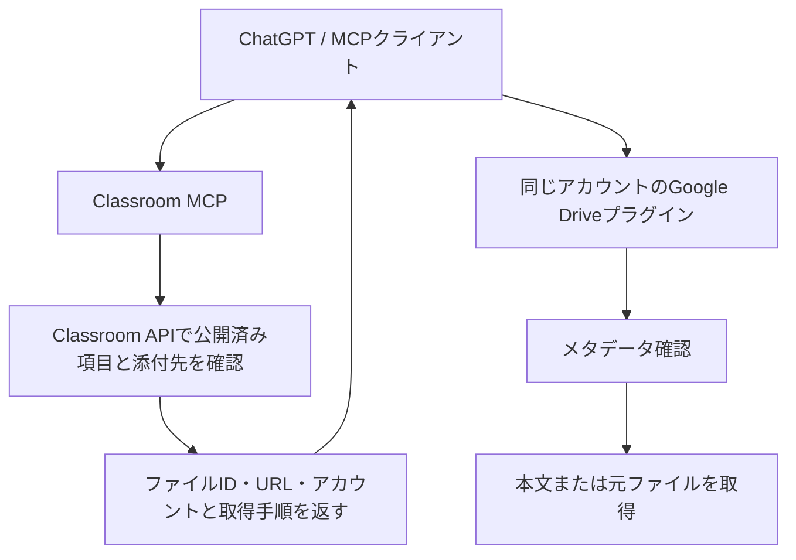

# Classroom資料とGoogle Driveプラグインの連携

更新日：2026-10-28。Classroom MCPは授業・課題・一般配布資料の説明と添付参照を取得します。本文と添付ファイルのダウンロードは、同じクライアントに接続したGoogle Driveプラグインへ引き継ぎます。

## 分担と取得経路



WorkerからChatGPT内のGoogle Driveプラグインを直接実行するAPIや認証はありません。MCPの応答に含む手順を使い、クライアントが実際にDriveプラグインを呼ぶ必要があります。本文取得はMCPの成功応答だけでは完了しません。Driveプラグインでの取得結果を確認してから「読めた」「ダウンロードできた」と判断します。

このWorkerはDrive APIのメタデータ・本文・バイナリを取得せず、PDF・Officeの解析も行いません。Google Driveプラグインのトークンや接続IDを受け取ることもありません。

## ツールと応答

| ツール                     | 用途                                                                |
| -------------------------- | ------------------------------------------------------------------- |
| `list_materials`           | 公開済み一般配布資料の一覧。更新日時の降順                          |
| `get_material`             | 指定した公開済み資料の説明と添付配列                                |
| `get_attachment_reference` | 課題・一般配布資料に付くファイルの参照とDriveプラグイン向け取得手順 |
| `get_attachment_content`   | 旧クライアント向け互換名。本文取得を行わず、同じ引き継ぎ情報を返す  |

一般配布資料はClassroomの`courseWorkMaterials.list/get`を使います。Googleの配列名は単数形の`courseWorkMaterial`です。一覧は`PUBLISHED`、`updateTime desc`に固定し、`nextPageToken`があれば空ページでも同じ条件で続けます。課題の添付参照にも対応します。

```json
{
  "courseId": "fixture-course",
  "sourceType": "material",
  "sourceId": "fixture-material",
  "attachmentIndex": 0
}
```

`sourceType`は`material`または`assignment`、`sourceId`はその資料IDまたは課題IDです。`attachmentIndex`は親項目の`materials`配列の0始まりの番号です。毎回Classroomで親項目と公開状態を確認します。任意のファイルID・URLを取得対象として渡すことはできません。

| 応答                                                               | 意味                                                                             |
| ------------------------------------------------------------------ | -------------------------------------------------------------------------------- |
| `courseId / sourceType / sourceId / sourceTitle / attachmentIndex` | Classroom上の出典                                                                |
| `attachment`                                                       | Classroomの添付情報。名前・説明・元URLは信頼されない資料データ                   |
| `fileId / title / url`                                             | Driveファイルの参照。実在・現在の共有権限はDriveプラグインで確認                 |
| `contentFetched: false`                                            | このMCPは本文・ファイルを取得していない                                          |
| `retrieval.provider: google_drive_plugin`                          | 本文・ファイルを取得する接続先                                                   |
| `retrieval.status: requires_client_action / performed: false`      | クライアントによるプラグイン呼び出しが未実施                                     |
| `retrieval.accountEmail`                                           | Classroomの認証済みアカウント。Drive接続の選択に使う                             |
| `retrieval.metadata`                                               | `get_file_metadata`向けのファイルID                                              |
| `retrieval.text`                                                   | 本文を読む`fetch`向けURL                                                         |
| `retrieval.file`                                                   | 元ファイルを読む`fetch`向けURLと`download_raw_file: true, include_base64: false` |
| `nextStep`                                                         | プラグインで続きを取得するための案内                                             |

`url`は確認したDrive IDから生成します。同じファイルのHTTPSのGoogle URLに含まれる有効な`resourcekey`だけは保持します。任意のホスト・認証情報・クエリを取得先へ転送しません。Drive以外のリンク、YouTube、Formsは`external_reference / reference_only`として元の参照を返し、Drive取得の対象にはしません。

互換名の`get_attachment_content`もDrive APIへ接続しません。`deprecated: true`と置き換え先を返し、旧`offset / maxChars`は受け付けても無視します。`text / nextOffset`は返しません。本文を待って同じMCPを繰り返し呼ばず、Driveプラグインへ進みます。

## クライアントでの実行手順

1. Classroomの一覧・詳細で対象資料を特定し、`get_attachment_reference`を呼びます。
2. `retrieval.accountEmail`と一致する接続済みGoogle Driveアカウントを選びます。接続IDはそのクライアントで現在使えるものを選び、MCPへ渡しません。アカウントが不明・未接続なら確認し、個人用など別の接続へ自動的に切り替えません。
3. Google Driveプラグインの`get_file_metadata`でファイルID・MIME型・参照先を確認します。
4. 本文なら`fetch(url=参照先)`、元のPDFやOfficeファイルなら`fetch(url=参照先, download_raw_file=true, include_base64=false)`を呼びます。Google形式の明示的な変換は、そのプラグインが提供するexport機能と制限に従います。
5. 返された本文や認証付きファイル参照を確認してから、要約・ファイルの提示へ進みます。ファイル名やURLだけで内容を推測しません。

クライアントが両方のプラグインを利用できることが前提です。Driveプラグインがない場合や、そちらでも共有設定・管理者ポリシーで拒否された場合はその状態を明示します。MCPへの再試行、別アカウントへの切り替え、制限の回避は行いません。対応形式・文字抽出品質・OCR・取得上限はDriveプラグインの仕様に従います。以前のMCP側の5 MiB・100ページ/スライド・50万文字の制限は撤去しました。

## 認可と移行

| MCP権限                    | Google権限                               | 用途                         |
| -------------------------- | ---------------------------------------- | ---------------------------- |
| `classroom:read`           | 授業と自分の課題の読み取り               | 従来の課題機能・課題添付参照 |
| `classroom:materials:read` | `classroom.courseworkmaterials.readonly` | 一般配布資料とその添付参照   |

`classroom:attachments:read`と`drive.readonly`はこのMCPの要求から削除しました。新規接続時も既存トークン更新時も、廃止したMCP権限は発行しません。Google更新トークンとOAuth認証情報の保存・暗号化、アカウント・有効期限・権限の検査は維持します。既にGoogle側へ付与された古いDrive権限の自動失効は行いません。

一般配布資料の権限がある既存接続は継続できます。クライアントのツール一覧・説明を更新し、Google DriveプラグインをClassroomと同じアカウントで接続してください。新しいMCP認可にはDrive APIの有効化やDriveスコープは不要です。詳しい導入・更新手順は[個人デプロイガイド](personal-deployment.md#更新する)を参照してください。

## 検証範囲

切り替え後の`npm run check`（設定検査・型検査・dry-runビルド・10ファイル78テスト・整形確認）、`npm audit --audit-level=moderate`（0件）、`git diff --check`が成功しました。

自動テストでは、Driveを管理者ポリシー相当で拒否するモックでも、Classroomへの1回の参照取得だけで引き継ぎが成立することを確認します。公開状態・ページング・添付番号・resourcekey・URL検証・アカウント情報・旧ツール互換・廃止権限の除外・本文未取得の明示を対象にします。workerdでもDrive APIのモックを提供せず、Classroom認可から参照取得までを検証します。入力上限と同時接続分離の回帰テストも維持します。

2026-10-28、ユーザー指定の講義PDF1件について、Classroomで添付先を特定し、接続済みGoogle Driveプラグインでメタデータ、本文7,128文字、元ファイル8,202,399バイトの認証付き参照を取得できました。インラインBase64は使用していません。実ファイルのID・本文・アカウント情報はリポジトリへ保存していません。この結果は対象PDFでの取得確認であり、他のファイルの共有権限や文字抽出精度を保証するものではありません。
