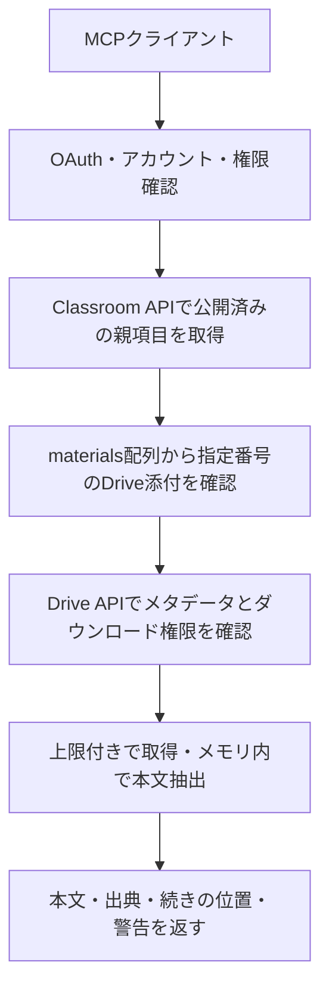

# Classroomの配布資料・添付本文の取得

設計・実装日：2026-10-28。課題に付属する資料に加え、「授業」に一般配布資料として投稿された項目を取得し、Drive添付ファイルの本文を読み取ります。課題の作成・提出・編集、共有設定の変更は行いません。

## 取得の流れ



外部URL、YouTube、Formsは一覧・詳細の参照情報として返します。URLをたどる取得処理は実装しません。Classroomの添付にないDriveファイルも対象外です。取得結果やファイルはKVへキャッシュせず、接続中のGoogleアカウントを毎回使用します。

## 追加ツール

| ツール                   | 入力                                                                                | 出力                                                        |
| ------------------------ | ----------------------------------------------------------------------------------- | ----------------------------------------------------------- |
| `list_materials`         | `courseId`、任意の`pageSize`・`pageToken`                                           | `materials`、`nextPageToken`                                |
| `get_material`           | `courseId`、`materialId`                                                            | 公開済み資料のタイトル・説明・日時・`materials`添付配列など |
| `get_attachment_content` | `courseId`、`sourceType`、`sourceId`、`attachmentIndex`、任意の`offset`・`maxChars` | 本文、出典、ファイル情報、分割取得情報、警告                |

`list_materials`は`courses.courseWorkMaterials.list`を使用します。Google側の配列名は単数形の`courseWorkMaterial`です。状態は`PUBLISHED`、並び順は`updateTime desc`に固定します。`nextPageToken`がある間は同じ`courseId`・`pageSize`で続け、空ページでも終了しません。1回の呼び出しで1ページだけ取得します。削除済み・下書き資料の取得は提供しません。

`get_material`のGoogle APIは`courses.courseWorkMaterials.get`です。状態が公開済みであることを確認します。返される本文・ファイル名・説明文は信頼されない資料データとして扱います。

本文取得の例：

```json
{
  "courseId": "12345",
  "sourceType": "material",
  "sourceId": "67890",
  "attachmentIndex": 0,
  "maxChars": 12000
}
```

`sourceType`は一般配布資料なら`material`、課題なら`assignment`です。`sourceId`にはそれぞれ`materialId`または`assignmentId`を指定します。`attachmentIndex`は親項目の`materials`配列の**0始まり**の番号です。先に一覧・詳細を取得して選びます。本文ツールに任意のURLや取得対象の`fileId`を渡すことはできません。

本文レスポンスには`courseId`・`sourceType`・`sourceId`・`attachmentIndex`・`fileId`・`name`・`mimeType`・`sourceUrl`・Googleが返した`modifiedTime`・`version`、および次の項目が含まれます。

| 項目         | 意味                                                  |
| ------------ | ----------------------------------------------------- |
| `text`       | 今回分の抽出本文                                      |
| `offset`     | 今回の開始位置。UTF-16コード単位                      |
| `totalChars` | ページ・スライド見出しも含む抽出本文の長さ            |
| `nextOffset` | 続きの開始位置。なければ取得終了                      |
| `truncated`  | 今回分の後に本文が残るか                              |
| `warnings`   | 読めない視覚情報、OCR未実施、空ページ、シート制限など |

既定の`maxChars`は12,000、最大50,000です。`nextOffset`があれば、元の入力条件を維持して`offset`をその値に変えます。毎回ファイルを再取得・抽出するため、取得中に`fileId`や`version`が変わった場合は前の断片を破棄して0から読み直してください。変更があるファイルの同一時点のスナップショットは保証しません。`version`が得られない場合も、更新の可能性を含めて扱います。

## 認可と既存接続

| MCP権限                      | Google権限                               | 対象                                           |
| ---------------------------- | ---------------------------------------- | ---------------------------------------------- |
| `classroom:read`             | 既存の授業・自分の課題読み取り           | 従来の5ツール                                  |
| `classroom:materials:read`   | `classroom.courseworkmaterials.readonly` | 一般配布資料の一覧・詳細                       |
| `classroom:attachments:read` | `drive.readonly`                         | Classroomへの添付を確認したDriveファイルの本文 |

一般配布資料の添付本文には後者2つのMCP権限が必要です。課題の添付本文には`classroom:read`と`classroom:attachments:read`が必要です。

新規接続時の同意画面には3つのMCP読み取り権限を表示します。Google側の`drive.readonly`は、アクセス可能な全Driveファイルを読み取れる広い権限です。Classroomの添付限定という制限はアプリ側の実装であり、Google側のスコープによる限定ではありません。この違いと本文の送信先を同意画面に記載します。`drive.file`は既存の授業添付ファイルを一般に読み取れるスコープではないため採用しません。

OAuthの同意開始時に権限を固定し、承認後に増やしません。Googleトークンに実際に付与されたスコープも記録します。MCPアクセストークンに含める権限は、MCPで同意した権限とGoogle権限の共通範囲です。Google更新トークンはアクセストークンのpropsへ含めません。

過去の接続は`classroom:read`のままで、資料・添付権限を自動付与しません。Google更新応答でscopeが省略された場合は保存済みの範囲だけを保持します。追加3ツールは一覧に表示されますが、必要な権限がなければGoogle APIへ接続せず再同意を案内します。従来の課題取得は継続できます。

導入時はGoogle CloudでDrive APIを有効にし、追加のGoogleスコープを設定した後、更新をデプロイしてMCPを再接続します。詳しい手順は[個人デプロイガイド](personal-deployment.md#更新する)を参照してください。学校管理者による許可や、公開アプリの制限付きスコープの審査要件はGoogle側で確認します。

## 対応形式と制限

| 形式                                | 方法と制約                                                                                                         |
| ----------------------------------- | ------------------------------------------------------------------------------------------------------------------ |
| PDF                                 | Worker対応のPDF.jsでページ順に文字抽出。最大100ページ。文字のないページを警告。OCRなし                             |
| DOCX                                | ZIP内の`word/document.xml`の本文・段落・表の文字を抽出。ヘッダー・フッター・コメント・埋め込みオブジェクトは対象外 |
| PPTX                                | `presentation.xml`の参照順でスライド本文を抽出。最大100スライド。ノートと埋め込みオブジェクトは対象外              |
| Google Docs / Slides                | Drive `files.export`で`text/plain`へ変換                                                                           |
| Google Sheets                       | Drive `files.export`でTSVへ変換。最初のシートだけであることを常に警告                                              |
| TXT / Markdown / CSV / TSV          | UTF-8として読み取り。別の文字コードは自動推定しない                                                                |
| DOC / PPT / XLS、画像、動画、その他 | 対象外として明示。原本を開く                                                                                       |

取得前に`capabilities.canDownload`を確認します。共有権限やダウンロード禁止は回避しません。Driveのショートカットも自動解決しません。Drive APIの認証付きリクエストは固定のGoogleホストだけへ送り、HTTPリダイレクトを追跡しません。

ダウンロード・Google形式のエクスポートとも最大5 MiBです。メタデータや`Content-Length`の判定だけに依存せず、ストリームから読んだ実バイト数も制限します。OOXMLでは必要なXMLだけをストリーム展開し、実際の展開合計10 MiB、ZIP内2,000項目、XMLネスト100を上限とします。DTD・独自エンティティ宣言は拒否し、マクロ・外部リレーションを実行しません。抽出本文が50万文字を超えた場合は全体をエラーとして返し、完全取得に見せかけた部分結果は返しません。

ClassroomとDriveは同じ通信リトライ・合計45リクエスト・45秒のネットワーク処理予算を共有します。各通信は本文受信も含め最大15秒、キャンセルを伝播します。本文抽出にもページ間などでキャンセル確認を行いますが、同期解析中の処理時間・メモリをアプリだけで厳密に保証するものではありません。複雑なPDFは上記サイズ内でもWorkerプランのCPU・メモリ上限に達する場合があります。実際の講義資料で運用プランを確認してください。

文字抽出は原本の再現ではありません。画像・グラフ・数式・表の配置・読み順、PDFのフォントによる文字化けを完全には判定できません。PDFの文字が空でも「資料に内容がない」と判断せず、警告と原本を確認します。ユーザーの資料を外部OCRや解析サービスへ送る処理は含みません。

## 検証範囲

2026-10-28の依存更新後のローカル検証で`npm ci`、`npm run check`（設定検査、TypeScript、Wrangler dry-run、11ファイル・87テスト、Prettier）、`npm audit --audit-level=moderate`（0件）、`git diff --check`が成功しました。本番への反映は対象コミットのWorkers Buildsと公開エンドポイントで別途確認します。

モックAPIで一般配布資料のページング、添付関係、Google形式のexport、権限不足・共有制限・過大ストリーム・外部リンク・破損ファイル・ZIP展開上限・キャンセルを検証します。合成したPDF、Wordの日本語と段落、PowerPointの参照順を実データのバイト列でテストします。workerdでも3形式の本文抽出と、OAuth同意からMCP経由で資料一覧・詳細・添付本文を取得する流れを確認します。

実Googleアカウント、学校の管理者ポリシー、日本語を含む実講義PDFの抽出品質、本番CPU・メモリ使用量、ChatGPT再接続後の実ツール利用は、実環境での確認が必要です。ローカルテストやdry-run成功をその代わりとは扱いません。

## 参照

- [Classroom: courseWorkMaterials.list](https://developers.google.com/workspace/classroom/reference/rest/v1/courses.courseWorkMaterials/list)
- [Classroom: courseWorkMaterials.get](https://developers.google.com/workspace/classroom/reference/rest/v1/courses.courseWorkMaterials/get)
- [Drive: ダウンロードとエクスポート](https://developers.google.com/workspace/drive/api/guides/manage-downloads)
- [Google Workspaceのexport対応形式](https://developers.google.com/workspace/drive/api/guides/ref-export-formats)
- [Driveのスコープと審査](https://developers.google.com/workspace/drive/api/guides/api-specific-auth)
- [unpdf](https://github.com/unjs/unpdf)、[fflate](https://github.com/101arrowz/fflate)、[fast-xml-parser](https://github.com/NaturalIntelligence/fast-xml-parser)
